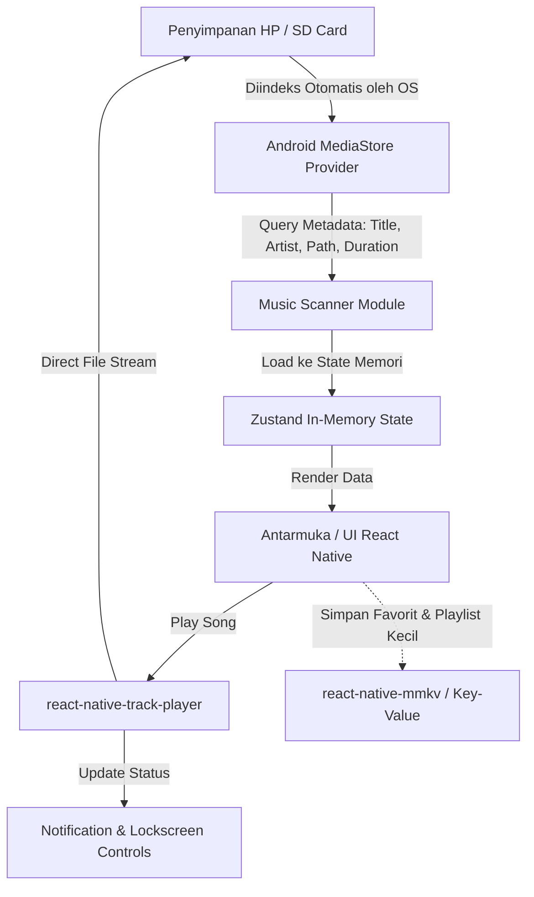

# Product Requirement Document (PRD): Offline Local Music Player

* **Nama Proyek (Tentatif):** PulseMusic / SoundLocal  
* **Platform:** Mobile (Android Utama, iOS Opsional)  
* **Teknologi:** React Native (TypeScript)  
* **Penyimpanan:** No Server DB (MediaStore API + Local Key-Value Storage)  
* **Status Dokumen:** Draf Awal (V1.0)  
* **Tanggal:** 2026-11-09  

---

## 1. Ringkasan Eksekutif & Latar Belakang

Banyak pengguna memiliki koleksi file audio pribadi (MP3, WAV, FLAC, AAC) di memori ponsel mereka dan menginginkan pemutar musik yang ringan, bebas iklan, tanpa login akun, dan berfungsi 100% secara offline tanpa memerlukan koneksi internet maupun server backend.

Proyek ini bertujuan untuk membangun aplikasi pemutar musik lokal berbasis **React Native** yang secara otomatis mendeteksi dan mengindeks file audio dari penyimpanan perangkat pengguna, memutarnya dengan lancar, serta mendukung kontrol latar belakang (*background playback* & *lockscreen widget*).

---

## 2. Tujuan & Indikator Keberhasilan (KPI)

### 2.1 Tujuan Produk
1. **Zero-Setup & Instan**: Pengguna hanya perlu memberikan izin akses file satu kali, dan seluruh musik langsung terdeteksi otomatis.
2. **100% Offline & Privasi Terjaga**: Tidak ada data yang dikirim ke server luar; data file tetap berada di perangkat pengguna.
3. **Pengalaman Audio Mulus**: Musik tetap berputar saat aplikasi di-minimize, layar dimatikan, atau saat pengguna membuka aplikasi lain.

### 2.2 Metrik Kunci
* **Waktu Pemuatan Awal (*Cold Start Scan*)**: < 2 detik untuk membaca 500+ file lagu.
* **Stabilitas Pemutaran**: 0% *crash* akibat memory leak saat memutar audio berjam-jam di background.
* **Performa List**: 60 FPS saat scrolling daftar lagu panjang (>1000 item).

---

## 3. Arsitektur Data: Konsep Tanpa Database (*No-DB Strategy*)

Aplikasi ini tidak membutuhkan database relasional (SQL/NoSQL) atau server eksternal. Seluruh aliran data memanfaatkan arsitektur hybrid perangkat:



### Penjelasan Komponen:
1. **OS MediaStore (Single Source of Truth):** Sistem operasi Android sudah mengindeks file audio lokal. Aplikasi membaca daftar ini melalui *Content Resolver*.
2. **In-Memory State (Zustand / React Context):** Seluruh daftar lagu ditampung di RAM aplikasi selama aktif untuk pencarian dan pemfilteran instan.
3. **Local Key-Value Storage (MMKV / AsyncStorage):** Hanya digunakan untuk menyimpan konfigurasi ringan yang bersifat personal, seperti daftar ID lagu favorit (`["id_1", "id_4"]`) dan pengaturan shuffle/repeat.

---

## 4. Kebutuhan Fungsional (Feature Requirements)

### FR-1: Manajemen Izin Akses Media (Permissions)
* **FR-1.1**: Menampilkan *dialog penjelasan* (*rationale*) yang ramah sebelum meminta izin sistem.
* **FR-1.2**: Mendukung izin granular Android:
  * Android 13+ (API 33+): `android.permission.READ_MEDIA_AUDIO`
  * Android 12 kebawah: `android.permission.READ_EXTERNAL_STORAGE`
* **FR-1.3**: Penanganan kondisi jika izin ditolak (menampilkan layar panduan untuk mengaktifkan izin via Pengaturan HP).

### FR-2: Pemindaian & Tampilan Musik (Audio Scanning & Library)
* **FR-2.1**: Otomatis memindai file audio yang valid (ekstensi: `.mp3`, `.m4a`, `.wav`, `.flac`, `.aac`).
* **FR-2.2**: Membaca metadata file:
  * Judul Lagu (*Title*)
  * Nama Artis / Penyanyi (*Artist*)
  * Nama Album (*Album*)
  * Durasi Lagu (*Duration*)
  * Gambar Sampul (*Album Artwork*)
* **FR-2.3**: Pengurutan (*Sorting*): Berdasarkan Judul (A-Z), Artis, Tanggal Ditambahkan, dan Durasi.
* **FR-2.4**: Fitur *Pull-to-Refresh* untuk memindai ulang jika pengguna baru saja mendownload lagu baru.

### FR-3: Pemutar Audio (Audio Playback Engine)
* **FR-3.1 Kontrol Dasar**: Play, Pause, Next Track, Previous Track.
* **FR-3.2 Seeking**: Slider progress bar untuk memajukan/memundurkan durasi lagu secara presisi.
* **FR-3.3 Mode Putar**:
  * *Loop Single*: Mengulang 1 lagu terus-menerus.
  * *Loop All*: Mengulang seluruh antrean playlist.
  * *Shuffle*: Memutar antrean secara acak.
* **FR-3.4 Audio Focus Handling**: Otomatis pause jika ada panggilan telepon masuk, dan resume saat panggilan selesai.

### FR-4: Pemutaran Latar Belakang & Notifikasi (Background Playback)
* **FR-4.1 Foreground Service**: Musik tetap aktif saat layar dimatikan atau aplikasi diminimalkan.
* **FR-4.2 Notification Media Controls**: Menampilkan cover album, judul, artis, tombol Play/Pause, Next, dan Previous di bilah notifikasi sistem Android.
* **FR-4.3 Lockscreen Widget**: Kontrol media terintegrasi di layar kunci perangkat.

### FR-5: Mini Player & Now Playing Modal
* **FR-5.1 Mini Player**: Bar kecil melayang di bagian bawah layar saat lagu sedang aktif, memungkinkan navigasi ke halaman lain tanpa menghentikan musik.
* **FR-5.2 Now Playing Screen**: Layar penuh dengan artwork album besar, waveform/slider, lirik (opsional tahap lanjutan), dan tombol kontrol lengkap.

### FR-6: Fitur Favorit & Custom Playlist Sederhana (Tanpa DB)
* **FR-6.1 Favorit (Heart Icon)**: Menandai lagu yang disukai; data disimpan lokal via MMKV.
* **FR-6.2 Custom Playlist**: Pengguna dapat membuat nama playlist baru dan menambahkan lagu ke dalamnya (disimpan dalam bentuk array JSON lokal).

---

## 5. Kebutuhan Non-Fungsional

| Kategori | Spesifikasi / Standar |
| :--- | :--- |
| **Performa UI** | Menggunakan FlatList virtualized (`@shopify/flash-list`) untuk memastikan scrolling 60 FPS pada koleksi > 2.000 lagu. |
| **Konsumsi Daya** | Efisiensi baterai saat *background playback* dengan memanfaatkan API native Media3 / ExoPlayer. |
| **Kompatibilitas** | Minimal Android 8.0 (Oreo, API 26) hingga Android 15+. |
| **Ukuran APK** | < 25 MB (optimalisasi ProGuard/R8 dan arsitektur split APK). |

---

## 6. Arsitektur UI & Informasi Halaman

```
[ Tab 1: Tracks ]       --> Daftar semua file lagu (List View)
[ Tab 2: Artists ]      --> Dikelompokkan per nama penyanyi
[ Tab 3: Albums ]       --> Dikelompokkan per album cover
[ Tab 4: Playlists ]    --> Tab Favorit & Playlist buatan pengguna
------------------------------------------------------------------
[ Floating Mini Player] --> Muncul di bawah saat lagu aktif
------------------------------------------------------------------
[ Modal: Now Playing ]  --> Tampilan penuh saat Mini Player diklik
```

---

## 7. Rekomendasi Tech Stack & Dependensi

* **Core Framework:** React Native CLI (TypeScript) atau Expo (dengan Config Plugins / Prebuild).
* **Audio Playback:** `react-native-track-player` (standar industri untuk pemutar musik latar belakang di RN).
* **File Scanner:** `react-native-get-music-files` atau modul native *MediaStore ContentResolver*.
* **Permission Handler:** `react-native-permissions`.
* **State Management:** `zustand` (sangat ringan dan cepat dibanding Redux).
* **Fast Local Cache (Favorit/Playlist):** `react-native-mmkv`.
* **Icon Set:** `lucide-react-native` atau `react-native-vector-icons`.

---

## 8. Rencana Implementasi & Roadmap


1. **Milestone 1 (Sprint 1):** Inisialisasi proyek, konfigurasi izin Android (`READ_MEDIA_AUDIO`), dan pengambilan data lagu dari MediaStore.
2. **Milestone 2 (Sprint 2):** Integrasi `react-native-track-player`, implementasi tombol Play/Pause/Seek, dan pembuatan Mini Player.
3. **Milestone 3 (Sprint 3):** Konfigurasi Background Service, integrasi notifikasi sistem Android, dan penanganan audio focus.
4. **Milestone 4 (Sprint 4):** Penyimpanan lokal (Favorit & Playlist via MMKV), fitur pencarian (*Search*), dan pengurutan (*Sorting*).
5. **Milestone 5 (Sprint 5):** Optimalisasi kinerja daftar lagu, uji coba pada berbagai versi Android, dan pembuatan rilis `.apk`.
